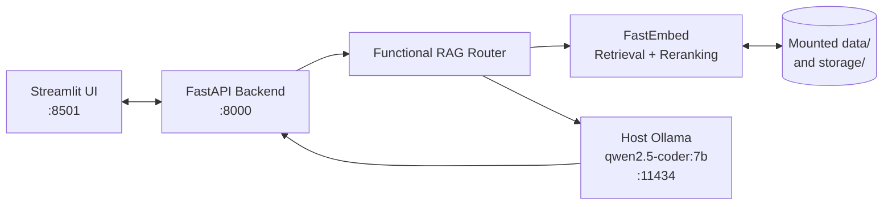

# Financial Agentic RAG

> **Containerized 10-K Intelligence Platform with Metadata-Filtered & Global Routing**

[](https://www.python.org/)
[](https://fastapi.tiangolo.com/)
[](https://streamlit.io/)
[](https://docs.docker.com/compose/)
[](https://ollama.com/)
[](https://qdrant.github.io/fastembed/)
[](https://qdrant.tech/)
[](https://docs.ragas.io/)

A containerized Retrieval-Augmented Generation system for asking grounded questions about SEC 10-K and 10-Q filings. It is designed as a practical financial research assistant: a user asks a natural-language question, the system determines the appropriate retrieval scope, finds and reranks relevant filing passages, and generates an answer with the retrieved context available for inspection.

The project demonstrates a production-minded separation of concerns without hiding the core RAG workflow behind a monolithic application. Streamlit handles interaction, FastAPI exposes the backend contract, the retrieval layer owns embeddings and ranking, and a locally hosted Ollama model performs answer synthesis. Documents and vector artifacts remain persistent on the host through Docker bind mounts.

## Why This Project

Financial questions have different retrieval shapes. A question about Adobe's 2022 risk factors should not compete with every filing in the corpus, while a question comparing revenue growth across companies must search broadly. This project makes that distinction explicit in the routing layer:

- **Filtered RAG** narrows retrieval using detected company and filing-year metadata before reranking. It is optimized for precise, document-specific questions.
- **Global RAG** searches across the available corpus and synthesizes evidence from multiple filings. It is optimized for comparisons, trends, and questions that do not name one filing.

That routing decision is returned by the API alongside the answer and source contexts, making the system's behavior observable rather than opaque.

## Key Features

- **Functional RAG routing:** Automatically selects Filtered RAG for targeted filing questions and Global RAG for multi-document synthesis.
- **Decoupled services:** Streamlit provides the user interface while FastAPI owns query orchestration and retrieval.
- **Hybrid retrieval:** FastEmbed vectors, metadata filters, reranking, and persistent local vector data support grounded responses.
- **Local LLM execution:** Ollama runs `qwen2.5-coder:7b` on the host, avoiding external model API costs for development and evaluation.
- **Persistent data mounts:** Source documents and runtime storage are mounted into the backend container through Docker Compose.
- **Evaluation workflow:** FinanceBench samples can be evaluated with RAGAs metrics, including faithfulness, relevancy, precision, and recall.

## End-to-End Workflow

1. **Ingest:** SEC PDFs are placed under `data/raw_pdfs/pdfs/` and converted into structured document representations.
2. **Transform:** Filing text is cleaned, normalized, and split into stable chunks carrying company, year, filing type, and source metadata.
3. **Index:** FastEmbed generates dense vectors and the processed data is uploaded into the configured Qdrant collection. Hybrid retrieval combines vector and sparse text signals where available.
4. **Route:** The functional router inspects the query and extracts metadata when a company or filing year is identified.
5. **Retrieve and rerank:** Candidate chunks are retrieved, filtered when appropriate, and reranked with `BAAI/bge-reranker-v2-m3`.
6. **Generate:** Ollama runs `qwen2.5-coder:7b` on the host and produces the final answer from the selected context.
7. **Inspect and evaluate:** The API exposes the selected route and contexts, while the RAGAs script evaluates generated answers against FinanceBench samples.

## Engineering Design

- **Functional architecture:** The application is organized around focused functions for routing, retrieval, generation, ingestion, and evaluation rather than shared mutable service classes.
- **Service decoupling:** The frontend communicates only with the FastAPI API. The LLM is not bundled into either image, keeping container builds smaller and model lifecycle independent.
- **Local-first operation:** Ollama runs on the developer's machine and is reached from Docker through `host.docker.internal`. This supports private financial-document workflows and predictable evaluation costs.
- **Inspectable responses:** `/query` returns `route`, `answer`, and `contexts`, which makes it possible to debug retrieval quality and review evidence in the Streamlit interface.
- **Persistent artifacts:** `./data` and `./storage` are mounted into the backend container so parsed documents and vector data survive container recreation.

## Architecture



The frontend calls the backend over the Docker Compose network. The backend reaches Ollama through `host.docker.internal`, while document and vector artifacts remain on the host through bind mounts.

## Repository Layout

```text
RAG/
├── app.py                         # Streamlit frontend
├── docker-compose.yml             # Backend/frontend orchestration
├── Dockerfile.backend
├── Dockerfile.frontend
├── requirements.txt
├── .env.example
├── data/
│   ├── raw_pdfs/pdfs/             # Input SEC filings (local, ignored)
│   ├── processed/                 # Generated parsed/chunked/vector data
│   └── benchmarks/jsons/          # Evaluation datasets
├── parsed_docs/                   # Parser and chunk manifests
├── scripts/
│   ├── 01_ingest_documents.py
│   ├── 02_chunk_documents.py
│   ├── 03a_generate_embeddings.py
│   ├── 03b_upload_to_qdrant.py
│   ├── 04_run_pipeline.py
│   ├── 05_evaluate_ragas.py
│   └── serve_pdfs.py
├── src/
│   ├── agents/                    # Routing and LLM tools
│   ├── api/                       # FastAPI application
│   ├── evaluation/                # RAGAs integration
│   ├── generation/                # Answer synthesis
│   ├── ingestion/                 # Parsing and chunking
│   ├── retrieval/                 # Hybrid retrieval and reranking
│   └── transform/                 # SEC document cleaning
└── storage/                       # Runtime vector storage (ignored)
```

## Prerequisites

- Docker Desktop with Docker Compose
- Ollama installed on the host
- Python 3.10 or newer for local scripts and tests
- At least 8 GB of available memory for embedding, reranking, and local LLM workloads

## Quickstart

1. Clone the repository and enter it:

	```bash
	git clone [https://github.com/farhat-zenim/financial-agentic-rag.git](https://github.com/farhat-zenim/financial-agentic-rag.git)
	cd financial-agentic-rag
	```

2. Place SEC filings in `./data/raw_pdfs/pdfs/`. Keep the existing directory structure; PDF files are intentionally ignored by Git because they are large source artifacts.

3. Start Ollama and download the configured model:

	```bash
	ollama pull qwen2.5-coder:7b
	```

4. Build and launch both services:

	```bash
	docker-compose up --build
	```

Open the Streamlit interface at <http://localhost:8501>. The backend API is available at <http://localhost:8000>.

### Optional local pipeline preparation

The numbered scripts can be run from the repository root when preparing new filings:

```bash
python scripts/01_ingest_documents.py
python scripts/02_chunk_documents.py
python scripts/03a_generate_embeddings.py
python scripts/03b_upload_to_qdrant.py
```

The exact input and output locations are controlled by the repository's data-processing code and environment configuration.

## API

### Health check

```bash
curl http://localhost:8000/health
```

Example response:

```json
{"status":"ok","service":"RAG Backend Engine"}
```

### Query

```bash
curl -X POST http://localhost:8000/query \
  -H "Content-Type: application/json" \
  -d '{"query":"What were Adobe major risk factors in 2022?"}'
```

The response contains the selected `route`, generated `answer`, and retrieved `contexts`:

```json
{
  "route": "FILTERED_RAG",
  "answer": "...",
  "contexts": ["..."]
}
```

Example routing prompts:

- **Filtered RAG:** `What were Adobe's major risk factors in 2022?`
- **Filtered RAG:** `What was 3M's gross margin in the 2021 10-K?`
- **Global RAG:** `Compare revenue growth across all available technology filings.`

## Testing

Run the API smoke checks locally or against the running containers:

```bash
curl http://localhost:8000/health
curl -X POST http://localhost:8000/query \
	-H "Content-Type: application/json" \
	-d '{"query":"What is Adobe revenue?"}'
```

## Evaluation

With the backend container running and the benchmark dataset available under `data/benchmarks/jsons/`, run the implemented RAGAs evaluation script inside the backend container:

```bash
docker exec -it rag_backend python scripts/05_evaluate_ragas.py
```

The evaluation executes the routed queries and reports RAGAs metrics using the local Ollama model. Ensure Ollama is running and `qwen2.5-coder:7b` is available before starting the evaluation.

## Configuration

Copy `.env.example` to `.env` for local overrides. Common settings include `OLLAMA_MODEL`, `OLLAMA_HOST`, embedding and reranker model names, Qdrant settings, and document paths. Never commit `.env` or credentials.

## License

Add the project's preferred license before publishing the repository.
